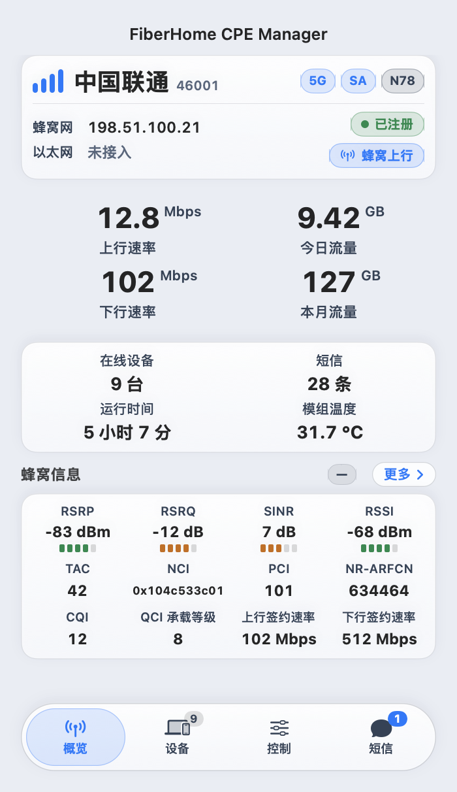
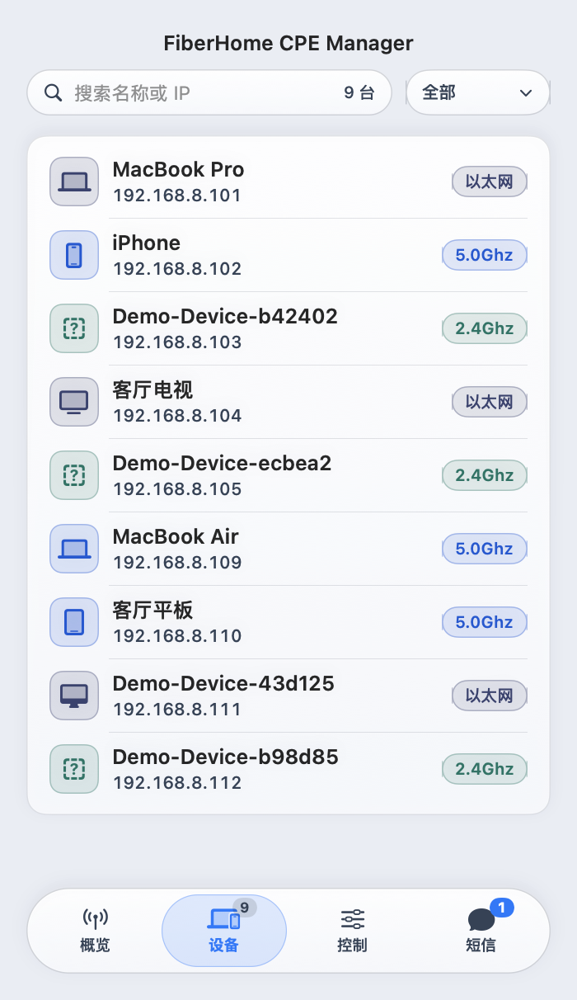
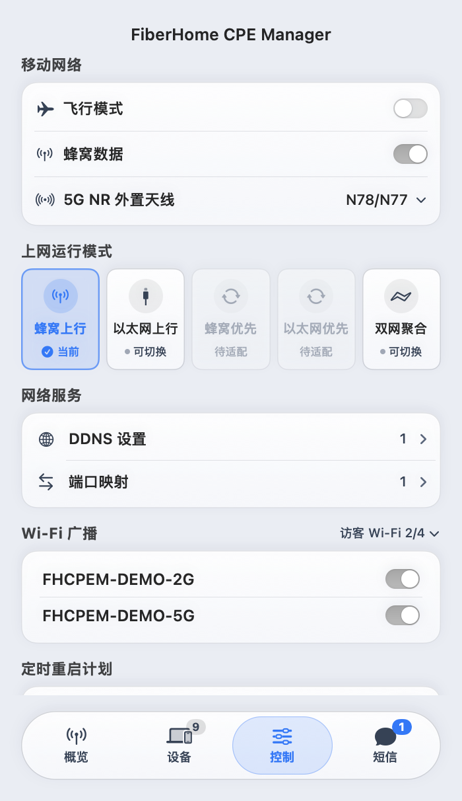
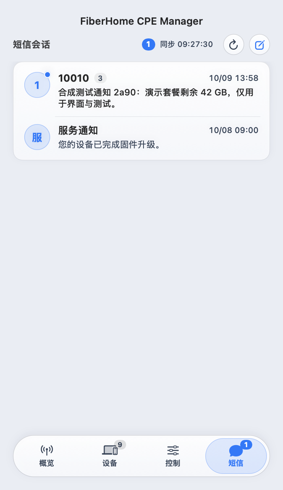

# FiberHome CPE Manager

烽火 CPE 的原生 macOS 菜单栏管理工具。查看蜂窝信号、网速、在线设备和短信，也可以直接管理常用网络与硬件设置。

当前版本 **1.0-Beta** · Apple Silicon · macOS 14 及以上 · Apache-2.0

## 界面预览

| 概览 | 设备 |
| --- | --- |
|  |  |
| 控制 | 短信 |
|  |  |

## 已实现

| 模块 | 功能 |
| --- | --- |
| 概览 | 动态信号、运营商、蜂窝参数、实时上下行速率、今日与本月流量 |
| 基站与小区 | 服务小区、邻区、载波信息，小区锁定与频段锁定互斥操作 |
| 设备 | 搜索、接入类型筛选、通用设备图标与手动指定、静态 IP 绑定 / 解绑、复制 IP / MAC |
| 移动网络 | 飞行模式、蜂窝数据、外置天线，以及已适配的上网模式 |
| 网络服务 | DDNS、端口映射新增与编辑、Wi-Fi 广播与名称管理 |
| 硬件 | 定时 / 立即重启与自动重连、指示灯、风扇模式 |
| 短信 | 会话、发送、自动同步、可见会话自动已读 |
| 菜单栏与桌面 | 信号与网速显示、重新登录、桌面磁贴 |

数据每 3 秒刷新。关闭面板后仍继续刷新并续期当前会话；断线时清空设备和短信，未知指标显示为 `—`，正常读取的零速率显示为 `0`。

流量与原厂 WebUI 使用相同口径：按 1024 进制换算并保留 KB、MB、GB 标记。网速使用十进制 Kbps、Mbps、Gbps。

## 未完成功能

| 功能 | 当前状态 | 说明 |
| --- | --- | --- |
| MLO 多链路聚合 | 占位展示 | 我没有 Wi-Fi7 设备，用不上懒得做 |
| 蜂窝优先 | 占位展示 | 难道你是富哥同时续费流量卡再插着宽带？ |
| 以太网优先 | 占位展示 | 难道你是富哥同时续费流量卡再插着宽带？ |

## 使用

1. 打开 DMG，将应用拖入 Applications 后启动。应用入口位于 macOS 菜单栏。
2. 点击信号图标，输入设备管理地址、账号和密码；首次启动自动预填默认网关，也可手动探测。
3. 按需启用保存密码。密码保存在系统钥匙串，短信与会话令牌只保留在内存中。

其他入口重新登录可能使当前会话失效。此时应用会清空数据并返回登录页，也可以从菜单栏右键菜单主动重新登录。

目前已适配 LG6851F / RP0112。其他型号与固件的验证范围见 [兼容性](docs/COMPATIBILITY.md)。

## 构建与打包

需要 Swift 6 和匹配的 macOS SDK。当前验证环境为 Swift 6.4 / MacOSX26.5.sdk；脚本在该 SDK 可用时优先使用。

```sh
./script/build_and_run.sh       # 构建并运行
./script/build_dmg.sh           # 构建 Apple Silicon Release DMG
```

应用输出到 `build/FiberHomeCPEManager.app`；Release 安装包与 `SHA256SUMS` 输出到 `build/release/`。构建产物不进入 Git。

```sh
./script/test.sh
python3 -m unittest discover -s script -p 'test_*.py'
```

- [开发与打包说明](docs/DEVELOPMENT.md)
- [测试流程](docs/TESTING.md)
- [界面与交互](docs/UI-SPEC.md)
- [隐私与本地数据](docs/PRIVACY.md)

## 适配其他设备

买不起，不做

## 许可证

项目采用 [Apache License 2.0](LICENSE)，版权说明见 [NOTICE](NOTICE)。
